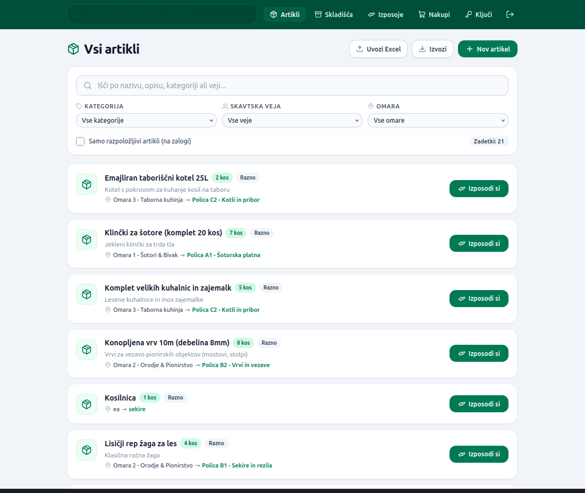
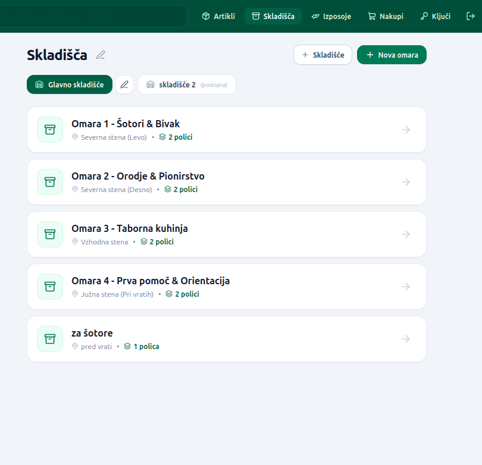
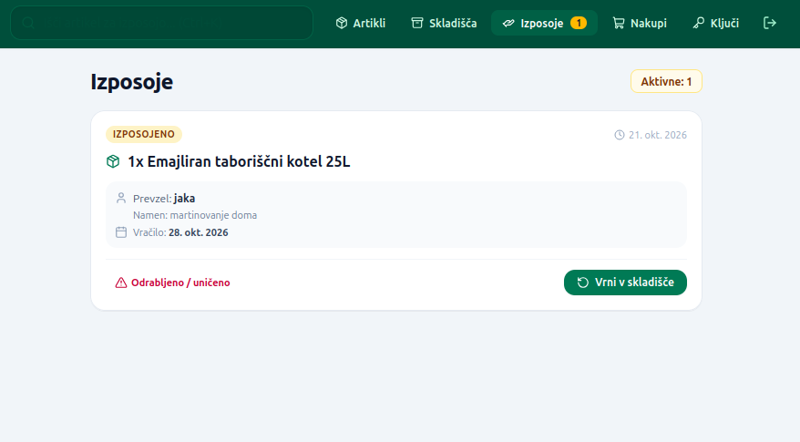
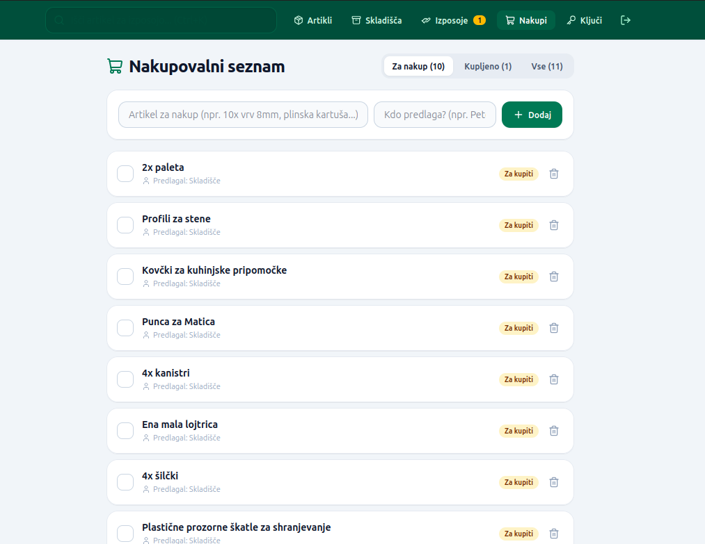
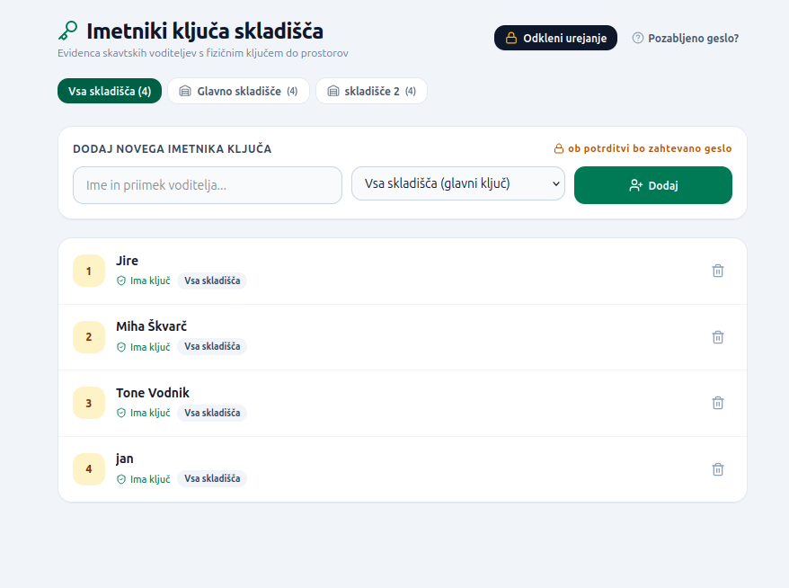

# Skavtsko Skladišče / Scout Warehouse App

Sodobna spletna aplikacija za enostavno, pregledno in učinkovito vodenje skavtskega skladišča opreme, evidenco izposoj, nabave ter upravljanje skrbnikov ključev.

---


## Opis projekta
**Skavtsko Skladišče** je MERN aplikacija (MongoDB, Express, React, Node.js), prilagojena potrebam skavtskih stegov in voditeljev. Omogoča hiter pregled nad vsemi artikli, natančno lokacijo opreme (soba -> omara -> polica), beleženje izposoj članom ter vodenje nakupovalnega seznama za manjkajočo ali poškodovano opremo.

### Glavne funkcionalnosti
- 📦 **Upravljanje artiklov in zalog**: Pregled, iskanje in filtriranje opreme po kategorijah in lokacijah, generiranje QR kod ter enostaven uvoz podatkov preko Excel / CSV preglednic.
- 🗄️ **Hierarhična struktura skladišča**: Organizacija prostora po nivojih: *Skladišča / Sobe ➔ Omare ➔ Police ➔ Artikli*.
- 🔄 **Sistem izposoj in vračil**: Hitra izposoja opreme voditeljem ali vejam, pregled aktivnih izposoj ter možnost avtomatskega dodajanja poškodovanih/obrabljenih artiklov na nakupovalni seznam ob vračilu.
- 🛒 **Nakupovalni seznam**: Spremljanje potrebnih nakupov potrošnega materiala ali novih kosov opreme s statusi nabave.
- 🔑 **Skrbniki ključev**: Evidenca oseb, ki imajo ključe skladišča, skupaj s kontaktnimi podatki za hiter dogovor o prevzemu.
- 🔒 **Varnost in avtentikacija**: Zaščiten dostop z JWT žetoni ter ponastavitev gesla s potrditveno kodo preko e-pošte.

---

### Slike aplikacije (Screenshots)

#### Pregled artiklov (Artikli)


#### Hierarhija skladišča (Sobe, omare in police)


#### Izposoja opreme


#### Nakupovalni seznam


#### Skrbniki ključev



---

### Uporabljene tehnologije
- **Frontend**: React 19, Vite, Tailwind CSS v4, React Router 7, Lucide Icons, SheetJS (`xlsx`)
- **Backend**: Node.js, Express, MongoDB Atlas, Mongoose, JWT (`jsonwebtoken`), Nodemailer, QRCode, Swagger UI

---

### Namestitev in lokalni zagon

#### 1. Predpogoji
- Node.js (v18+)
- npm
- MongoDB Atlas račun ali lokalna MongoDB baza

#### 2. Backend
```bash
cd backend
npm install
```
Ustvarite datoteko `.env` v mapi `backend/`:
```env
PORT=3000
MONGO_URI=tvoja_mongodb_povezava
ACCESS_TOKEN_SECRET=tvoj_skrivni_jwt_kljuc (izmisli si ga)
```
Zagon backend strežnika:
```bash
npm run dev
```
*API dokumentacija (Swagger) je na voljo na `http://localhost:3000/api-docs`.*

#### 3. Frontend
```bash
cd frontend
npm install
```
Ustvarite datoteko `.env` v mapi `frontend/`:
```env
VITE_API_URL=http://localhost:3000
```
Zagon razvojnega strežnika:
```bash
npm run dev
```

---

## Project Overview
**Scout Warehouse App** is a MERN-stack web application designed for scout troops to streamline warehouse inventory management, track equipment loans, manage replenishment shopping lists, and keep a directory of key holders.

### Key Features
- 📦 **Inventory & Item Management**: Fast search, filtering by category and location, QR code generation, and bulk data import via Excel/CSV spreadsheets.
- 🗄️ **Warehouse Hierarchy**: Logical spatial breakdown: *Rooms / Warehouses ➔ Closets ➔ Shelves ➔ Articles*.
- 🔄 **Equipment Borrowing & Returns**: Simple check-out flow for troop leaders, tracking of active loans, and prompt to add damaged/depleted items directly to the shopping list upon return.
- 🛒 **Shopping List**: Centralized tracking of supplies, replacements, and newly needed gear.
- 🔑 **Key Custodians**: Contact directory of individuals who hold warehouse keys for easy access coordination.
- 🔒 **Security & Authentication**: Protected routes with JWT authentication and secure email verification codes for password recovery.

---

### Application Screenshots

#### Inventory Overview


#### Storage Rooms, Closets & Shelves


#### Borrowing Equipment


#### Shopping List


#### Key Holders


---

### Tech Stack
- **Frontend**: React 19, Vite, Tailwind CSS v4, React Router 7, Lucide Icons, SheetJS (`xlsx`)
- **Backend**: Node.js, Express, MongoDB Atlas, Mongoose, JWT (`jsonwebtoken`), Nodemailer, QRCode, Swagger UI

---

### Installation & Setup

#### 1. Prerequisites
- Node.js (v18+)
- npm
- MongoDB Atlas database or a local MongoDB instance

#### 2. Backend Setup
```bash
cd backend
npm install
```
Create a `.env` file in the `backend/` folder:
```env
PORT=3000
MONGO_URI=your_mongodb_connection_string
ACCESS_TOKEN_SECRET=your_jwt_secret (make it up)
```
Run the backend server:
```bash
npm run dev
```
*Interactive API documentation (Swagger UI) is available at `http://localhost:3000/api-docs`.*

#### 3. Frontend Setup
```bash
cd frontend
npm install
```
Create a `.env` file in the `frontend/` folder:
```env
VITE_API_URL=http://localhost:3000
```
Run the frontend development server:
```bash
npm run dev
```
