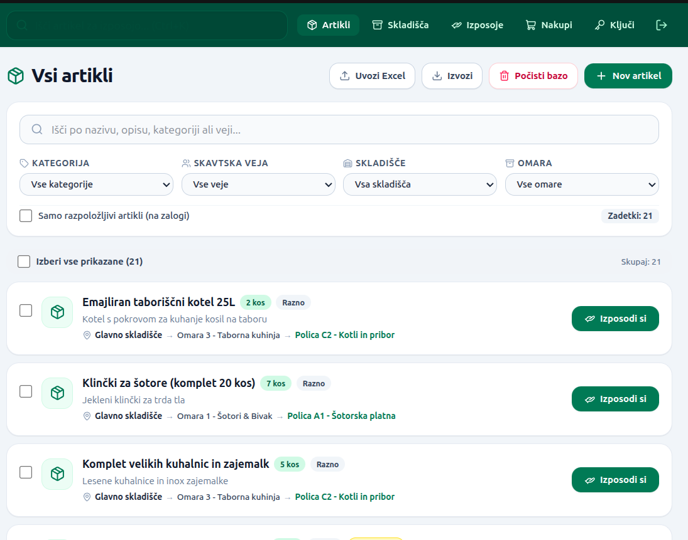
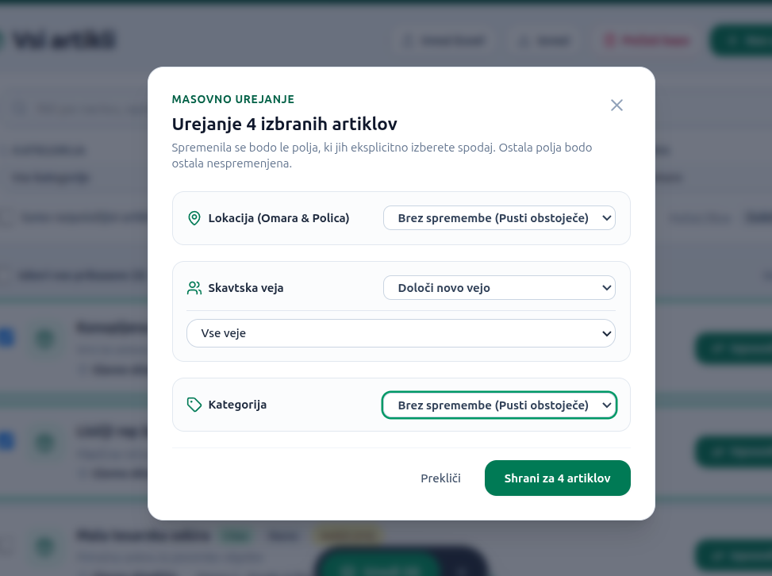
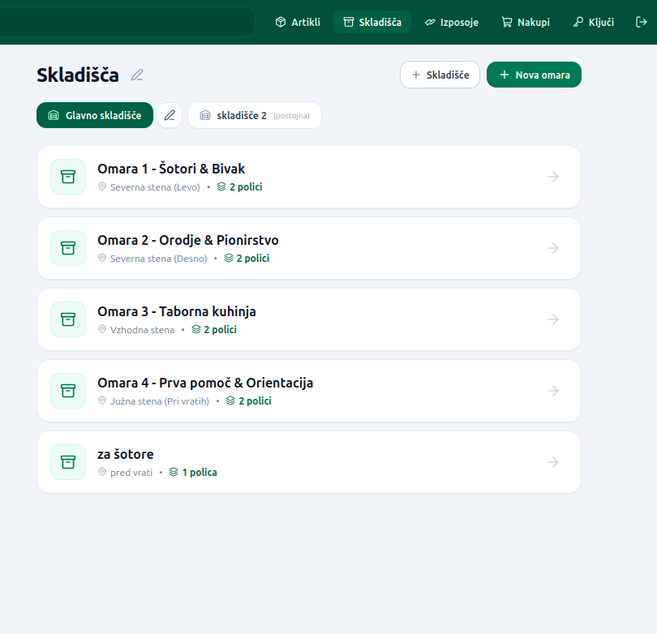
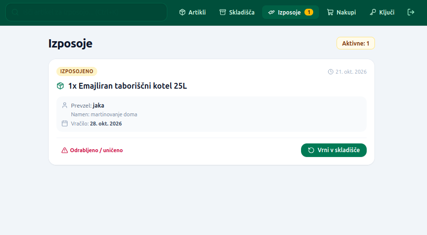
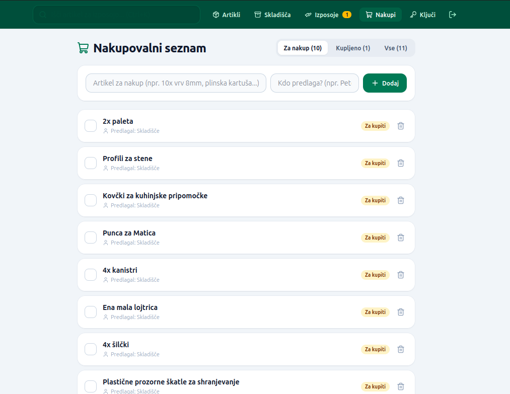
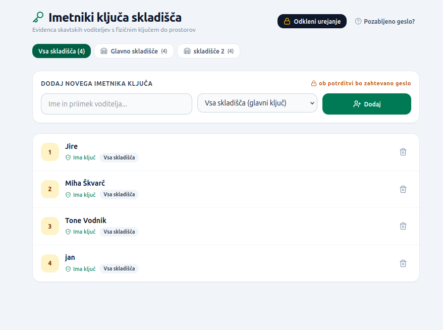

# Skavtsko Skladišče / Scout Warehouse App

### Glavne funkcionalnosti
- 📦 **Upravljanje artiklov in zalog**: Iskanje, filtriranje, masovno urejanje, uvoz/izvoz podatkov preko Excel preglednic.
- 🔄 **Sistem izposoj in vračil**
- 🛒 **Nakupovalni seznam**
- 🔑 **Skrbniki ključev za skladišča**
- 🔒 **Varnost in avtentikacija**: Evidenco ključev ureja samo gospodar, email preverjanje

---

### Slike aplikacije

#### Pregled artiklov

#### Masovno urejanje

#### Podpora več skladišč

#### Izposoja opreme

#### Nakupovalni seznam

#### Imetniki ključev

---

### Zaženi svojo aplikacijo na spletu brezplačno

Aplikacijo lahko brezplačno postavi vsak skavtski steg v približno 10–15 minutah brez programiranja. Potrebujete le 4 preproste korake:

---

#### 1. Kopiraj projekt na svoj račun (GitHub Fork)
1. Če še nimate, ustvarite stegov račun na [GitHub.com](https://github.com/).
2. Na vrhu te strani kliknite gumb **`Fork`** (zgoraj desno) ter nato **`Create fork`**. S tem dobite svojo osebno kopijo aplikacije. 
> How to fork: https://www.youtube.com/watch?v=LXewkvtfUGM

---

#### 2. Ustvari brezplačno bazo podatkov (MongoDB Atlas)
Tukaj se bodo varno hranili vsi vaši artikli, skladišča in izposoje.

1. Ustvarite stegov račun na [MongoDB Atlas](https://www.mongodb.com/cloud/atlas/register).
2. Ustvarite novo bazo s paketom **M0 Free**. Poljubno ime in nastavitve. 
3. **Uporabnik baze:** Določite poljubno uporabniško ime in geslo ter si ju shranite.
4. **Dostop do baze:** V levem meniju kliknite **Network Access** ➔ **Add IP Address** ➔ izberite **Allow Access from Anywhere** (`0.0.0.0/0`) ➔ potrdite.
5. **Povezovalni niz (Connection string):** Kliknite **Database** ➔ gumb **Connect** ➔ izberite **Drivers** ter kopirajte povezovalni niz na dnu (`mongodb+srv://username:<password>...`). Besedo `<password>` v nizu nadomestite s svojim geslom. **To boste potrebovali v naslednjem koraku.** Obdržite privzete nastavitve (Node.js). Ne zaganjajte install drver.

> How to create MongoDB Atlas Database: https://www.youtube.com/watch?v=7a2Nns23d_s

---

#### 3. Zaženi backend (Render)
Strežnik skrbi za shranjevanje podatkov, komunikacijo z bazo in prijave.
1. Ustvarite račun na [Render.com](https://render.com/) in se prijavite s stegovim GitHub računom.
2. Kliknite **New +** ➔ **Web Service** in izberite svoj forkani repozitorij.
3. Vnesite naslednje nastavitve:
   - **Root Directory:** `backend`
   - **Build Command:** `npm install`
   - **Start Command:** `npm start`
   - **Instance Type:** `Free`
4. Spodaj kliknite na **Environment Variables** (Okoljske spremenljivke) in dodajte:
   - `MONGO_URI` = *(vaš povezovalni niz (connection string) iz 2. koraka)*
   - `ACCESS_TOKEN_SECRET` = *(poljubno dolgo varno geslo ali naključno besedilo)*
   - `GMAIL_USER` = *(stegovski Gmail naslov za pošiljanje varnostnih kod za menjavo gesla)*
   - `GMAIL_PASS` = *(16-mestno App Password / geslo aplikacije iz vašega Google računa)*

> 💡 *Kako pridobiti `GMAIL_PASS`: V vašem Google računu vklopite 2-stopenjsko preverjanje in na povezavi [myaccount.google.com/apppasswords](https://myaccount.google.com/apppasswords) ustvarite novo geslo aplikacije (npr. z imenom "Skladisce").*
5. Kliknite **Manual Deploy - deploy latest commit**. Počakajte nekaj minut, da se izpiše status *Live*, nato na vrhu strani kopirajte povezavo do svojega strežnika (npr. `https://skladisce-backend.onrender.com`).

> How to deploy on render https://www.youtube.com/watch?v=A2VoUyZZMCw

---

#### 4. Objavi spletno aplikacijo (Cloudflare Pages)
To je spletna stran, ki jo boste uporabniki odprli na računalniku ali pametnem telefonu.
1. Ustvarite stegov račun na [Cloudflare.com](https://dash.cloudflare.com/).
2. V levem meniju izberite **Workers & Pages** ➔ **Create application** ➔ zavihek **Pages** ➔ **Connect to Git**.
3. Izberite svoj GitHub račun in ta forkani repozitorij.
4. Nastavitve gradnje (Build settings):
   - **Framework preset:** `Vite`
   - **Root directory:** `frontend`
   - **Build command:** `npm run build`
   - **Build output directory:** `dist`
5. V razdelku **Environment variables** dodajte spremenljivko:
   - `VITE_API_URL` = *(naslov vašega Render strežnika iz 3. koraka, npr. `https://skladisce-backend.onrender.com`)*
6. Kliknite **Save and Deploy**. Po zaključku je vaša aplikacija takoj na voljo na naslovu `https://nekaj.pages.dev`!

> How to deploy on cloudflare: https://www.youtube.com/watch?v=KlNPhoQQjmw
